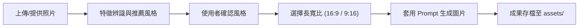

# 照片風格改圖指南 (Picture Style Change)

本專案專為搭配 **ChatGPT 圖像生成工具（DALL·E / GPT-4o 畫圖）** 設計，提供一套標準化的照片風格改圖工作流與精心調校的提示詞（Prompt）庫。

核心目標是在**保留原始照片主體身份、主要構圖與關鍵特徵**的前提下，將照片轉化為多種高質感的藝術技法與特殊視覺風格。

---

## 🎨 13 種精選視覺風格一覽

專案已收錄並整理出 13 種適用於不同情境的照片改圖風格（詳細 Prompt 請參閱 [`風格改圖整理.md`](風格改圖整理.md)）：

| 編號 | 風格名稱 | 視覺特徵與適用情境 |
|:---:|---|---|
| **01** | **層疊紙雕、手工剪紙** | 多層紙材堆疊、立體切邊陰影與溫暖手作紙感；適合營造繪本溫馨感。 |
| **02** | **搞笑醜萌塗鴉** | 粗糙蠟筆/麥克筆筆觸、誇張表情與不規則透視，具網路迷因幽默感。 |
| **03** | **MS Paint 笨拙重繪** | 白底、像素點點畫感，呈現刻意笨拙、荒謬且低畫質的趣味反差。 |
| **04** | **立體語意文字雕塑** | 以語意相關的英文單字取代物體材質結構，沿輪廓排列出瑞士平面編輯美學。 |
| **05** | **復古裝飾插畫海報** | 霧霾藍、奶油黃、鼠尾草綠平塗與復古襯線字排版，具滿版套色印花質感。 |
| **06** | **垂直折疊城市海報** | 地面由平視漸變向上折疊成 90 度垂直鳥瞰，適合展現城市建築縱深與大標題。 |
| **07** | **彩繪玻璃窗** | 透光彩色玻璃拼片與深色鉛條勾邊，重構人物、動植物與建築輪廓。 |
| **08** | **微縮模型移軸效果** | 俯視角、窄景深焦平面與模型塗裝感，將真實街景轉化為袖珍微縮世界。 |
| **09** | **藍曬植物標本** | 古典深普魯士藍與白色剪影，仿氰版攝影手工印相與紙質纖維紋理。 |
| **10** | **木刻凸版海報** | 粗細刻版線條、大面積平塗色塊與手工墨痕，適合人像、動植物與風景。 |
| **11** | **分解軸測圖** | 沿裝配方向平移展開機械或建築部件，呈現產品說明書式的立體透視。 |
| **12** | **原創溫暖手繪動畫風** | 細膩手繪線條、柔和水彩光影與日常奇幻氛圍，風格原創溫馨。 |
| **13** | **厚塗油畫微景觀** | 刮刀肌理、多層顏料堆疊與起伏邊緣；大面積暖白留白並以色帶承托空間切片。 |

---

## 🚀 推薦作業流程 (SOP)

當使用者提供照片後，依以下標準流程引導完成改圖：



1. **辨識與挑選風格**：閱讀使用者照片，由 13 種風格中挑選最契合照片主體的 6～10 項供使用者選擇。
2. **選定長寬比例**：確認使用者偏好畫幅為橫版 `16:9` 或直版 `9:16`。
3. **執行生成**：結合選定風格 Prompt 與比例指令，發送至圖像生成工具；嚴禁捏造不存在的細節或破壞主體身份。
4. **成果歸檔**：生成完成後將圖片存檔於 `assets/` 目錄中，並以簡短英文底線命名。

---

## 📁 專案檔案結構

```text
picture_style_change/
├── assets/                  # 生成圖片成果與範例資產
│   └── kaohsiung_papercut_16x9.png
├── AGENTS.md                # AI 代理（ChatGPT / Claude / Antigravity）作業規範
├── README.md                # 專案介紹與操作手冊（本檔）
├── 風格改圖整理.md          # 13 種風格清單與 8 段特殊作圖標準提示詞庫
└── 文獻整理.md              # 原始對話紀錄、出處與 Prompt 備份
```

---

## 📜 授權與維護

- 本專案提示詞與規則由日常實踐累積整理，遵循繁體中文（台灣用語）規範編寫。
- 專案維護：[erniesu8090-beep](https://github.com/erniesu8090-beep)
