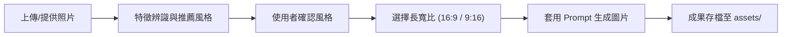

# 照片風格改圖指南 (Picture Style Change)

本專案專為搭配 **ChatGPT 圖像生成工具（DALL·E / GPT-4o 畫圖）** 設計，提供一套標準化的照片風格改圖工作流與精心調校的提示詞（Prompt）庫。

核心目標是在**保留原始照片主體身份、主要構圖與關鍵特徵**的前提下，將照片轉化為多種高質感的藝術技法與特殊視覺風格。

---

## 🎨 15 種精選視覺風格一覽

專案已收錄並整理出 15 種適用於不同情境的照片改圖風格（詳細 Prompt 請參閱 [`風格改圖整理.md`](風格改圖整理.md) 或開啟 [`風格型錄.html`](風格型錄.html)）：

| 編號 | 風格名稱 | 視覺特徵與適用情境 |
|:---:|---|---|
| **01** | **層疊紙雕、手工剪紙** | 多層紙材堆疊、立體切邊陰影與溫暖手作紙感；適合營造繪本溫馨感。 |
| **02** | **搞笑醜萌塗鴉** | 粗糙蠟筆/麥克筆筆觸、誇張表情與不規則透視，具網路迷因幽默感。 |
| **03** | **立體語意文字雕塑** | 以語意相關的英文單字取代物體材質結構，沿輪廓排列出瑞士平面編輯美學。 |
| **04** | **復古裝飾插畫海報** | 霧霾藍、奶油黃、鼠尾草綠平塗與復古襯線字排版，具滿版套色印花質感。 |
| **05** | **垂直折疊城市海報** | 地面由平視漸變向上折疊成 90 度垂直鳥瞰，適合展現城市建築縱深與大標題。 |
| **06** | **彩繪玻璃窗** | 透光彩色玻璃拼片與深色鉛條勾邊，重構人物、動植物與建築輪廓。 |
| **07** | **微縮模型移軸效果** | 俯視角、窄景深焦平面與模型塗裝感，將真實街景轉化為袖珍微縮世界。 |
| **08** | **藍曬植物／山水標本** | 古典深普魯士藍與白色剪影，仿氰版攝影手工印相與紙質纖維紋理。 |
| **09** | **木刻凸版海報** | 粗細刻版線條、大面積平塗色塊與手工墨痕，適合人像、動植物與風景。 |
| **10** | **分解軸測圖** | 沿裝配方向平移展開機械或建築部件，呈現產品說明書式的立體透視。 |
| **11** | **原創溫暖手繪動畫風** | 細膩手繪線條、柔和水彩光影與日常奇幻氛圍，風格原創溫馨。 |
| **12** | **厚塗油畫微景觀** | 刮刀肌理、多層顏料堆疊與起伏邊緣；大面積暖白留白並以色帶承托空間切片。 |
| **13** | **歐洲復古鋼筆雕刻繪本** | 1950–1960 年代歐漫排線技法、青藍與暖紅復古配色、孔版印刷紙感。 |
| **14** | **解構瑞士符號海報** | 後數位圖形設計與解構瑞士風格，提煉 2~3 個核心特徵幾何符號，大面積暖白留白。 |
| **15** | **靜謐棉紙水彩雜誌海報** | 高級手作棉紙冷壓質感，微灰水彩剪影與高級生活雜誌（Kinfolk 風）詩意排版。 |

---

## 🚀 推薦作業流程 (SOP)

當使用者提供照片後，依以下標準流程引導完成改圖：



1. **辨識與挑選風格**：閱讀使用者照片，由 15 種風格中挑選最契合照片主體的 6～10 項供使用者選擇。
2. **選定長寬比例**：確認使用者偏好畫幅為橫版 `16:9`、直版 `9:16`、海報 `3:4` 或正方 `1:1`。
3. **執行生成**：
   - **方式一（對話框 / ChatGPT）**：在網頁或對話中複製 Prompt 貼上發送。
   - **方式二（網頁工作台一鍵直出）**：雙擊根目錄 `啟動風格改圖器.bat`，在瀏覽器上傳照片、選風格與畫幅比例，並可自由選擇生圖模型（預設為 **GEMINI**，亦可切換為 **CODEX**），點擊「立即生成」即可自動算圖出圖，完全免 API Key！
4. **成果歸檔**：生成完成後圖片自動歸檔於 `assets/generated/`，並可在網頁歷史藝廊即時預覽與下載。

---

## 📁 專案檔案結構

```text
picture_style_change/
├── assets/                  # 成果與素材資產
│   ├── generated/           # 自動生成之成果圖檔
│   ├── uploads/             # 本機上傳之參考照片
│   ├── reference_*.jpg      # 基準示範照片（台北101、湖光山色旅拍）
│   └── kaohsiung_papercut_16x9.png
├── src/
│   └── server.py            # 本地輕量雙引擎橋接服務器（Zero-dependency Python）
├── 啟動風格改圖器.bat        # 雙擊一鍵啟動本地 Web 工作台
├── 風格型錄.html            # 現代互動風格型錄與工作台（支援深淺色、上傳與一鍵生圖）
├── AGENTS.md                # AI 代理作業規範
├── README.md                # 專案介紹與操作手冊（本檔）
├── 風格改圖整理.md          # 15 種風格清單與標準提示詞庫
└── 文獻整理.md              # 原始對話紀錄、出處與 Prompt 備份
```

---

## 📜 授權與維護

- 本專案提示詞與規則由日常實踐累積整理，遵循繁體中文（台灣用語）規範編寫。
- 專案維護：[erniesu8090-beep](https://github.com/erniesu8090-beep)
